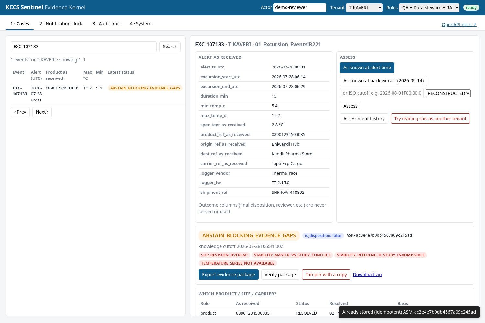

# KCCS Sentinel Evidence Kernel: case-study submission

**Candidate:** Zulfiqar · **Brief:** *The Adjudication Problem* (Kestrel Cold Chain Solutions, 18 Sep 2026)

**In one sentence:** when a temperature alert fires, this system gathers the evidence a QA reviewer needs: the right product, the SOP in force on that date, the right stability study and the regulatory deadline. It uses only that customer's data, records exactly what it used, and **says "not enough evidence" instead of guessing**. It never makes the product decision; a named human does.

It runs as a **command-line tool**, a **REST API** (FastAPI, OpenAPI docs) and a small **web UI**, all on the same core code.

| | |
|---|---|
| Tests | **131 passed** (with the workbook) · ruff clean · mypy clean |
| End-to-end | **47 of 47 checks pass** (`scripts/e2e_check.sh`; logs in [`evidence/`](evidence/E2E_EVIDENCE.md)) |
| Brief case | EXC-107133 → `ASM-ac3e4e7b0db4567a09c245ad`: abstains, names 4 blocking evidence gaps and the human actions |



---

## Quickstart

You need the workbook `KCCS_Sentinel_Reference_Data_Pack.xlsx`. It is confidential and not in the repo; `data/` is gitignored.

```bash
git clone https://github.com/Zulfiqar7862/kccs-sentinel-interview-ready.git
cd kccs-sentinel-interview-ready
git checkout improve/interview-ready
mkdir -p data && cp /path/to/KCCS_Sentinel_Reference_Data_Pack.xlsx data/
```

### Option A: local (Python 3.11+ and make)

```bash
make demo        # creates .venv, installs, runs the CLI demo, then serves the API + UI
```

Then open:
- **http://127.0.0.1:8000/ui/** for the web UI;
- **http://127.0.0.1:8000/docs** for the OpenAPI docs.

Stop with Ctrl+C.

Other targets (`make help`):

| Command | What it does |
|---|---|
| `make install` | Create `.venv` and install the package and dev tools |
| `make check` | ruff, mypy and pytest: the same as CI |
| `make test` | Tests only |
| `make e2e` | Fresh venv, every check, refreshes `evidence/` (about 30 s) |
| `make run` | API and UI with the real clock (no demo) |
| `make docker-build` / `make docker-up` | Container image / compose stack |
| `make clean` | Remove venvs, caches and `artifacts/` (never `data/` or `evidence/`) |

### Option B: Docker

```bash
docker compose up --build          # http://localhost:8000/ui/
```

- The container runs as a non-root user and mounts `./data` read-only.
- State is kept in the named volume `kccs-state`.
- The healthcheck uses `/health/ready`.
- Without the workbook, the container still starts, but readiness reports 503.

### Option C: no make (any OS with Python 3.11+)

```bash
python3 -m venv .venv && . .venv/bin/activate
pip install -e ".[dev]"
pytest                                   # 131 passed
kccs-evidence demo --workbook data/KCCS_Sentinel_Reference_Data_Pack.xlsx --out-dir artifacts --now 2026-11-08T12:00:00Z
KCCS_FIXED_NOW=2026-11-08T12:00:00Z kccs-evidence serve --port 8000
```

Configuration is through environment variables (`KCCS_*`), all documented in [`.env.example`](.env.example).

---

## Where to find each deliverable

| The brief asks for | Where it is |
|---|---|
| **A. Where you land**: requirements, what I won't build, first customer, contradictions, board targets I challenge | [docs/01_where_we_land.md](docs/01_where_we_land.md) |
| **B. The design (HLD)**: context, C4 containers and components, data flow, deployment, scaling, tenancy, residency, failure modes, cost, trade-offs | [docs/02_architecture_hld.md](docs/02_architecture_hld.md) |
| **B. The design (LLD)**: time model, data model, class and sequence diagrams, state machines, API contracts, errors, algorithms | [docs/03_detailed_design_lld.md](docs/03_detailed_design_lld.md) |
| Architecture decisions | [docs/adr/](docs/adr/README.md) (10 ADRs) |
| Every brief requirement → code → endpoint → test | [docs/USE_CASE_COVERAGE.md](docs/USE_CASE_COVERAGE.md) |
| **C. Something running**, and how we know it works | Code in [src/kccs_evidence/](src/kccs_evidence/), tests in [tests/](tests/), validation in [docs/05_validation_and_operations.md](docs/05_validation_and_operations.md), proof in [evidence/](evidence/E2E_EVIDENCE.md) |
| **D. Working log** | [docs/06_working_log.md](docs/06_working_log.md) |
| Interview prep: pitch, 20-minute script, demo, Q&A, code tour | [docs/INTERVIEW_GUIDE.md](docs/INTERVIEW_GUIDE.md) |
| Data findings | [docs/04_data_findings_and_assumptions.md](docs/04_data_findings_and_assumptions.md) |
| Every command with expected output | [docs/STEP_BY_STEP.md](docs/STEP_BY_STEP.md) |

## The brief's own case, EXC-107133

The brief describes Priya spending 1 hour 50 minutes on this insulin alert. Open [evidence/results/EXC-107133_assessment_excerpt.json](evidence/results/EXC-107133_assessment_excerpt.json) to see what the system finds from the data alone:

| Question the reviewer had to answer | What the system found |
|---|---|
| Which product is this? | GTIN `08901234500035` matched to Kaveri's own product record (the same GTIN also exists for 3 other customers, which it does not look at) |
| Which SOP revision was in force? | **Two revisions (Rev 02 and Rev 03) of SOP-KAV-9392 were both in force that day.** It flags the conflict instead of picking one |
| Which stability study applies? | The product record points to **STB-3584, a study for the vial, not the pen**, and it is partly unreadable, so it is rejected. The correct pen study **STB-2738** is found and offered for confirmation |
| Is the regulator deadline at risk? | If notifiable, due **12 Aug 2026 06:31 UTC**, counted from when the alert arrived, not from when the excursion started |
| Can it decide? | **No.** It lists the human actions needed, ending with "Sign or decline the disposition: Site QA" |


## REST API at a glance

All tenant routes need the headers `X-Actor` and `X-Tenant-Scope`; `X-Roles` is optional. This header-based identity is for the prototype only; production would use OIDC (see [ADR 0008](docs/adr/0008-header-identity-prototype-oidc-production.md)). Errors are RFC 9457 `application/problem+json`.

| Purpose | Endpoint |
|---|---|
| Liveness / readiness (integrity self-check) / metrics | `GET /health/live` · `GET /health/ready` · `GET /metrics` |
| Versions, code fingerprint, config hashes | `GET /api/v1/system/info` |
| Ingest the workbook (PLATFORM_ADMIN) | `POST /api/v1/ingest` |
| List / read events (never outcome columns) | `GET /api/v1/tenants/{t}/events` · `GET /api/v1/tenants/{t}/events/{e}` |
| Assess at a knowledge cutoff (201 new / 200 same) | `POST /api/v1/tenants/{t}/events/{e}/assessments` |
| Assessment history / one assessment | `GET /api/v1/tenants/{t}/events/{e}/assessments` · `GET /api/v1/assessments/{id}` |
| Evidence package: export, verify, zip, tamper demo | `POST /api/v1/assessments/{id}/package` · `GET …/package/verify` · `GET …/package.zip` · `POST …/package/tamper-demo` |
| Notification queue (earliest deadline first) | `GET /api/v1/obligations/queue` · `GET /api/v1/tenants/{t}/obligations` |
| Move an obligation (REGULATORY_AFFAIRS, `Idempotency-Key`) | `POST /api/v1/tenants/{t}/obligations/{e}/transitions` |
| Append a correction (QA_DATA_STEWARD) | `POST /api/v1/tenants/{t}/corrections` |
| Audit trail | `GET /api/v1/tenants/{t}/audit` |

```bash
curl -s -H "X-Actor: demo-qa" -H "X-Tenant-Scope: T-KAVERI" -H "Content-Type: application/json" \
     -d '{"knowledge_cutoff":"alert"}' http://127.0.0.1:8000/api/v1/tenants/T-KAVERI/events/EXC-107133/assessments
```

Full contracts: [LLD §11](docs/03_detailed_design_lld.md#11-rest-api-contract-as-served-openapi-at-docs-and-openapijson).

---

## Four ideas behind the design

1. **Refuse rather than guess.** If evidence is missing or conflicting, the answer is "not enough evidence, here is what a human must do". On this workbook every alert ends that way. That is correct, because the workbook has no temperature series, no SOP text and no batch history, which are exactly what a safe decision needs. With only those gaps closed, 8 of the 420 alerts would be ready for a reviewer.
2. **One customer at a time.** Searches are limited to the requesting customer's data from the start, rather than filtered afterwards. This prevents incidents like the Meridian/Pinnacle near-miss in the brief.
3. **"What did we know then?" is a separate question from "what do we know now?"** Every result records the date it reflects and the date of the knowledge it used. Re-running the past gives the same answer, even after later corrections.
4. **Two clocks.** The product decision can wait for evidence; the regulator's deadline cannot. Notification is tracked separately from the moment the alert arrives.

---

## Project structure

```
.
├── README.md                    start here
├── FINAL_REPORT.md              summary of the whole submission
├── Makefile                     install / check / test / e2e / run / demo / docker-*
├── Dockerfile                   two-stage, non-root, healthcheck
├── docker-compose.yml           api service, ./data read-only, state volume
├── .env.example                 every KCCS_* setting
├── .github/workflows/ci.yml     ruff + mypy + pytest (3.11–3.13) + docker smoke test
├── pyproject.toml               pinned deps, ruff, mypy, pytest config
├── data/                        put the workbook here (gitignored)
├── docs/
│   ├── 01_where_we_land.md      deliverable A
│   ├── 02_architecture_hld.md   deliverable B: HLD
│   ├── 03_detailed_design_lld.md deliverable B: LLD
│   ├── 04_data_findings_and_assumptions.md
│   ├── 05_validation_and_operations.md
│   ├── 06_working_log.md        deliverable D
│   ├── 07_review_walkthrough.md
│   ├── INTERVIEW_GUIDE.md       pitch, demo script, Q&A, code tour
│   ├── USE_CASE_COVERAGE.md     brief → code → endpoint → tests
│   ├── STEP_BY_STEP.md          every command with expected output
│   ├── adr/                     10 architecture decision records
│   └── images/                  UI screenshots
├── evidence/                    recorded e2e run: 47/47 checks, logs, results
├── scripts/
│   ├── e2e_check.sh             fresh venv → lint → types → tests → CLI → API → UI
│   ├── run_all.sh               install, test and run the CLI demo
│   ├── inspect_workbook.py      data-quality report only
│   └── _python.sh               picks Python 3.11+
├── src/kccs_evidence/
│   ├── __init__.py              versions (kernel, ruleset, schemas)
│   ├── config/                  rules as data (JSON) + loader; hashed into every manifest
│   ├── domain/                  pure rules, no I/O
│   │   ├── records.py           source records, canonical JSON, row hashes
│   │   ├── model.py             Finding, Resolution
│   │   ├── temporal.py          UTC, half-open intervals, site-local dates
│   │   ├── resolution.py        product / facility / carrier within one tenant
│   │   ├── policy_sop.py        SOP revision in force; overlap → conflict
│   │   ├── stability.py         study admissibility
│   │   ├── signals.py           limits, firmware band, telemetry findings
│   │   ├── obligations.py       notification clock + state machine
│   │   └── ports.py             EvidenceReader protocol
│   ├── application/             use cases
│   │   ├── access.py            Principal, TenantView (guard before retrieval)
│   │   ├── assessment.py        build + store assessments, manifest, fingerprint
│   │   ├── package.py           evidence package export / verify
│   │   ├── evaluation.py        replay vs history (Dr Rao's condition)
│   │   ├── inspection.py        data-quality report
│   │   ├── demo.py, reporting.py  scripted demo, summaries
│   │   ├── service.py           KernelService facade (CLI + API)
│   │   └── ports.py             EvidenceStore protocol
│   ├── infrastructure/          adapters
│   │   ├── sqlite_store.py      append-only bitemporal store
│   │   └── workbook.py          openpyxl reader
│   └── interfaces/              composition roots (not fingerprinted)
│       ├── cli.py               kccs-evidence command
│       ├── api/                 FastAPI app, settings, errors, deps, schemas, routers/
│       └── web/                 static UI (index.html, app.js, styles.css)
└── tests/                       131 tests (unit, API contract, architecture, e2e-style)
```

---

## Reference

### What the tests prove

| Claim | Tests |
|---|---|
| Customers are isolated: cross-customer reads and exports are refused and logged; the same GTIN resolves separately per customer | `tests/test_tenant_isolation.py`, `tests/test_api.py` |
| Dates are handled correctly: SOP revision at the site's local date, boundaries, overlaps reported as conflicts | `tests/test_temporal.py` |
| No future knowledge leaks into the past | `tests/test_temporal.py`, `tests/test_service.py` (obligation queue) |
| Results are reproducible: same evidence gives the same ID; loading twice adds nothing | `tests/test_assessment.py`, `tests/test_ingestion_and_store.py` |
| Corrections never edit history | `tests/test_assessment.py`, `tests/test_ingestion_and_store.py`, `tests/test_api.py` |
| Evidence packages can't be silently altered; readiness detects a tampered stored assessment | `tests/test_package.py`, `tests/test_service.py` |
| It never makes a disposition (checked on all 420 alerts); past outcomes are not inputs | `tests/test_assessment.py` |
| Stability checks catch wrong product forms, unreadable studies and misleading paths | `tests/test_stability_and_signals.py` |
| Notification clock: starts at receipt, never paused, won't guess "next business day", survives a 1,912-alert storm and a restart | `tests/test_obligations.py`, `tests/test_api.py`, `tests/test_service.py` |
| Each reviewer question on tab 10 that the pack can answer | `tests/test_reviewer_questions.py` |
| API contract: 401/403/404/409/422/503 as problem+json, validation, request IDs, OpenAPI and UI served | `tests/test_api_contract.py`, `tests/test_api.py` |
| Architecture: layers depend inwards only; no framework in domain or application | `tests/test_architecture.py` |

### What is built, simulated, or design only

| Built and tested | Simulated or stubbed (clearly labelled) | Design only (documented, not built) |
|---|---|---|
| Workbook loading with row references; append-only versioned store; tenant access control; product, site and carrier matching; SOP selection; stability checks; firmware arithmetic; "as known then" replay; reproducible assessments; corrections; evidence packages; notification clock with persisted transitions; REST API + UI; health, readiness, metrics; evaluation against past cases | Temperature-series archive, SOP document text, batch history, regulator gateway; one labelled simulated correction in the demo; small synthetic test cases | Reviewer case workflow and signatures; closure policy; regional cells; source connectors; OIDC; optional language-model drafting; alerting rules |

### Limitations

- Every alert abstains on this workbook. It has no temperature series, no SOP text and no batch history, and those are exactly what a safe decision needs.
- Identity is header-based (prototype only). `/api/v1/system/info` is unauthenticated and lists tenant codes. Do not expose the server beyond localhost.
- SQLite with a single writer lock. The obligation ledger is rebuilt in memory from its event log. Production would use Postgres (see the HLD).
- Some interpretations (site scope, product-form keywords, notification rules, firmware bulletin) are my reading of the data and need QA or Regulatory Affairs approval. They are kept as config in [src/kccs_evidence/config/](src/kccs_evidence/config/).
- The 420 alerts are a hand-picked evidence pack, not a random sample. Counts are not accuracy or automation-rate estimates.
- CI is defined but has not been run on GitHub from this branch. Docker was verified in a sandbox that needed host networking for the build.

### Troubleshooting

| Problem | Fix |
|---|---|
| `Workbook not found` | Put the file in `data/` with exactly this name: `KCCS_Sentinel_Reference_Data_Pack.xlsx` |
| Many tests `skipped` | Same cause: the workbook is not in `data/` (the API contract and architecture tests still run) |
| `/health/ready` returns 503 | The workbook was not loaded; check `KCCS_WORKBOOK` and the server log |
| Port 8000 in use | `make demo PORT=8010` or `KCCS_PORT=8010 docker compose up` |
| macOS bundled `python3` is 3.9 | `brew install python@3.12`; the scripts pick 3.11+ automatically |
| `kccs-evidence: command not found` | `. .venv/bin/activate` or `python -m kccs_evidence` |

Results produced on your machine go to `artifacts/`, which is not committed.
