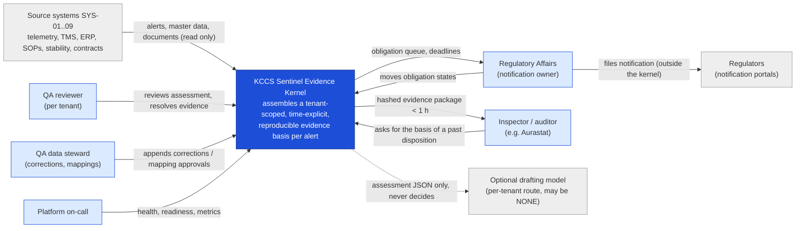
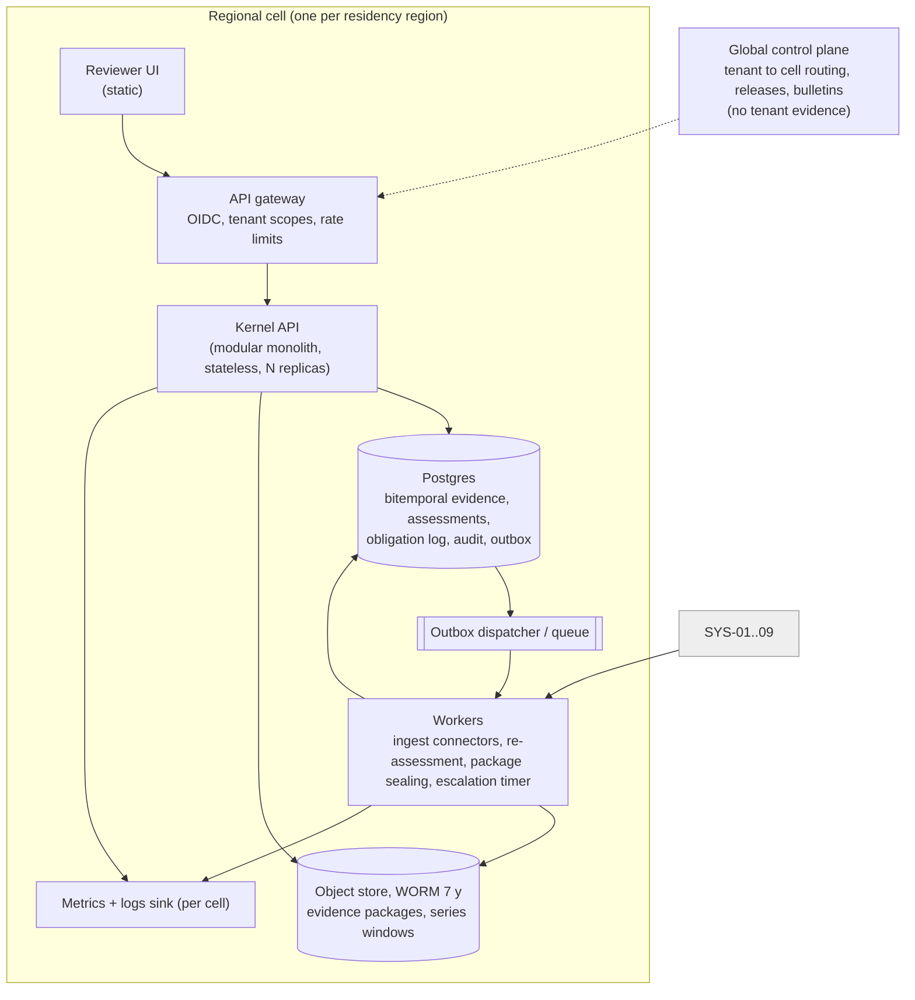
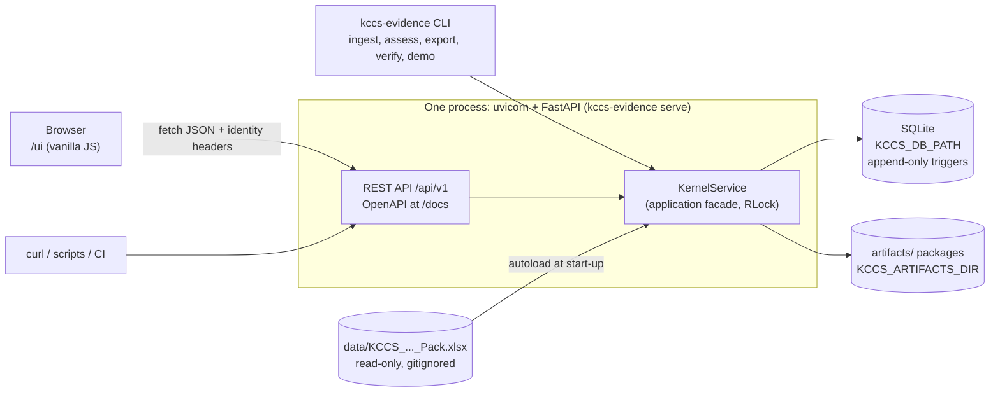
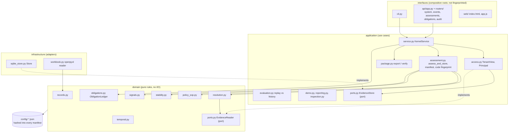
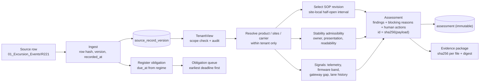
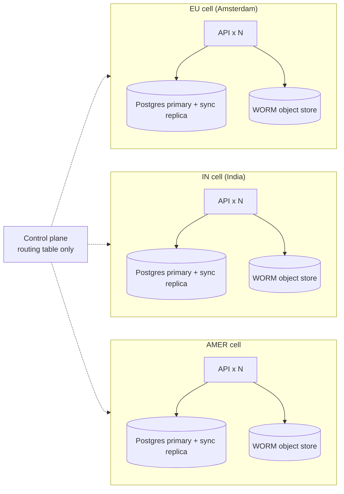
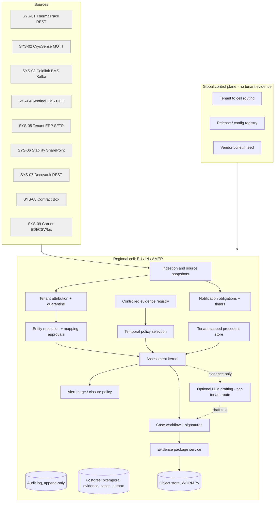
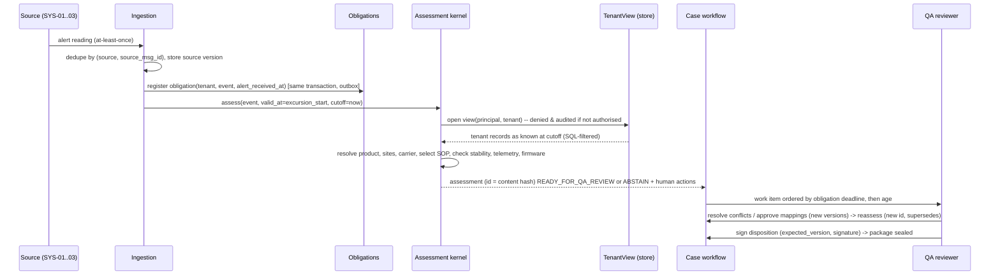
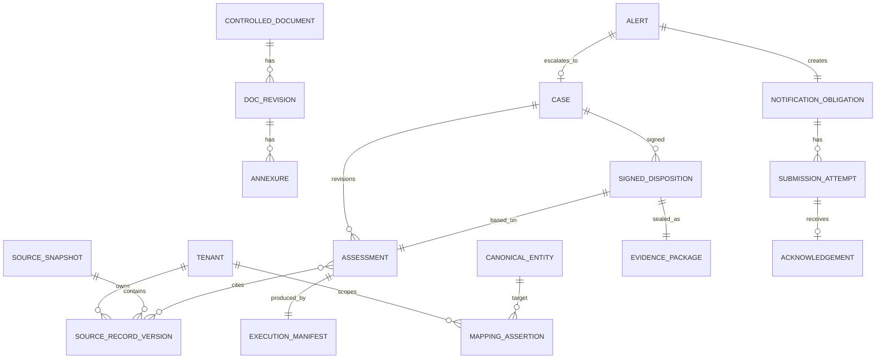

# 02 — Architecture (HLD)

Status legend used throughout: **[IMPL]** implemented in the prototype · **[SIM]** simulated/stubbed in the prototype · **[DESIGN]** proposed production behaviour, not built.

This document has two parts:
- **Part A** is the architecture at a glance: context, C4 containers and components, data flow, deployment, scale, tenancy, residency, failure modes and trade-offs. It covers both the production design and what the prototype actually runs.
- **Part B** is the production design in detail: components, the degradation table, versioning, data, tenant controls and cost.

Decisions are recorded as ADRs in [`adr/`](adr/README.md). The detailed design is in [`03_detailed_design_lld.md`](03_detailed_design_lld.md). Every number quoted for the prototype comes from `scripts/e2e_check.sh` (see `evidence/`).

---

# Part A — Architecture at a glance

## A1. System context (C4 level 1)

Who uses the system, and which systems it reads from. The **kernel never writes to a source system** and never decides a disposition.

## A2. Containers (C4 level 2)

### A2.1 Production design [DESIGN]: one cell (EU, IN or AMER)

### A2.2 Prototype as built [IMPL]

The prototype is one Python process plus a SQLite file. It runs the same way under `make demo`, `docker compose up` and the e2e script.

## A3. Components (C4 level 3): hexagonal layers inside the kernel [IMPL]

Dependencies point inwards only. `tests/test_architecture.py` enforces this by parsing every import.

| Layer | Allowed to import | Never imports |
|---|---|---|
| `domain` | stdlib, `config` | application, infrastructure, interfaces, FastAPI, pydantic, sqlite3, openpyxl |
| `application` | domain, config | infrastructure (except through the port), interfaces, any framework |
| `infrastructure` | domain, application ports | interfaces |
| `interfaces` | everything | — |

## A4. Data flow: one alert end to end

A **knowledge cutoff** applies to every read. The same alert assessed "as known at alert" (`alert`) and "as known at the pack extract" (`extract`) gives two different, linked assessments. For EXC-107133 these are `ASM-ac3e4e7b0db4567a09c245ad` and `ASM-9be5fe90a6a927d0887e37b5`, and the second records `supersedes` = the first. IDs are from the e2e run on the commit recorded in `evidence/environment.txt`.

## A5. Deployment

| Where | How | State | Verified |
|---|---|---|---|
| Laptop | `make demo` (venv, CLI demo, then API on `127.0.0.1:8000`) | `artifacts/api/kernel.sqlite` | Yes: fresh clone, see README |
| Docker | `docker compose up --build` (non-root, healthcheck on `/health/ready`) | named volume `kccs-state` | Image builds; container healthy and ready. In the build sandbox this needed host networking, a sandbox limit and not a repo setting |
| CI | GitHub Actions: ruff, mypy, pytest on 3.11/3.12/3.13; docker build plus liveness | none | Workflow file present; not run on GitHub from here |
| Production | One cell per region: gateway + N stateless API replicas + workers + Postgres (sync replica in-region) + WORM object store | Postgres, object store | [DESIGN] |

## A6. Scalability

| Dimension | Volume (pack, `13`) | Prototype | Production design |
|---|---|---|---|
| Alerts | ~11,400/month; storm 1,912 in 38 min | The full pack (420 events × 2 cutoffs + 1 correction = 841 assessments) in one demo run, about 30 s for the whole e2e including install | Stateless API replicas; ingest workers per source; assessments are idempotent, so a retry storm is safe |
| Telemetry readings | ~10 M/day | Not in the pack (series not available, so a blocking finding) | Columnar store; snapshot only the evidence window per alert at ingest |
| Writes | single writer | SQLite with one `RLock`; fine for a demo, **not** for concurrency | Postgres; optimistic versions; `SKIP LOCKED` workers |
| Obligations | one per alert | Rebuilt in memory from the event log at start-up | `due_at` and escalation columns, indexed (`state`, `due_at`) |
| Tenants | 34 | 8 in the pack | Partition by `tenant_code`; per-tenant queues with weighted fair dequeue |

The bottleneck is **people, not CPU**: curation of SOPs, studies and mappings per tenant (see `01` §6). The system is built so that curation work shows up as named blocking reasons.

## A7. Multi-tenancy [IMPL guard; DESIGN RLS]

- **Identity is (tenant, identifier).** GTIN 08901234500035 exists in four tenants and resolves only inside the caller's tenant.
- **Guard before retrieval:** `TenantView` checks scope, audits the attempt, then filters SQL by `tenant_code` ([ADR 0006](adr/0006-tenant-guard-before-retrieval.md)).
- **No outcome columns over the API:** the kernel never reads them, which an AST test checks.
- **Production second line:** Postgres row-level security on `app.tenant`, per-tenant indexes and caches, and leak canaries.

## A8. Data residency [DESIGN]

Regional cells (EU, IN, AMER). Tenant evidence never leaves its cell. Model routes are chosen per tenant: `NONE` for T-VIRENT and the 6 API-prohibited tenants, an EU zero-retention endpoint for T-AURA and T-NORDIA ([ADR 0010](adr/0010-regional-cells-for-residency.md)). Marieke's second question, "which version produced this recommendation?", is answered by the manifest inside every assessment ([ADR 0004](adr/0004-content-addressed-assessments.md)).

## A9. Failure modes (what the prototype does today)

| Failure | Prototype behaviour [IMPL] | How you see it |
|---|---|---|
| Workbook missing at start-up | API starts; `/health/live` 200; `/health/ready` **503**; data endpoints 503 problem+json | `kccs_ready 0`; CI docker job checks this |
| Someone edits a stored assessment in the DB | Triggers abort `UPDATE`/`DELETE`; if bypassed, readiness re-hashes all assessments and reports the IDs | `/health/ready` 503, `kccs_assessments_failing_hash > 0` |
| A package file is edited after export | `verify` fails naming the file ("hash mismatch assessment.json") | API `.../package/verify` → `ok: false`; CLI exit 2 |
| Cross-tenant request | 403 problem+json; `TENANT_VIEW_OPEN … DENIED` audit row | audit tab / `GET /tenants/{t}/audit` |
| Two RA users move the same obligation | Second gets **409** (stale `expected_version`) | e2e E43 |
| Client retries a transition | Same `Idempotency-Key` returns the stored result, `Idempotent-Replay: true` | `test_idempotency_key_cannot_be_reused_for_a_different_request` |
| Process restart | Obligation states rebuilt from `obligation_transition` | `test_obligation_transitions_survive_restart` |
| Regime cannot compute a deadline | Obligation kept with `due_at = null`, listed first, `escalate_now = true` | queue endpoint |
| Unhandled bug | 500 problem+json with `request_id`; stack trace only in the server log | JSON log line with the same `request_id` |

The production degradation table (source outages, model sunset, cell failover) is in Part B §4.

**"How would you know it stopped working at 3 a.m., six months from now?"** (brief deliverable C)
1. `/health/ready` re-checks the append-only triggers and re-hashes every stored assessment. It goes to 503 on any drift, and the orchestrator stops routing traffic.
2. `/metrics` exposes `kccs_ready`, `kccs_assessments_failing_hash`, `kccs_obligations_registered` and request counts by route and status. Proposed alerts: ready = 0 for 2 min; failing_hash > 0; any obligation with `escalate_now`; 5xx rate.
3. **Production [DESIGN]:** a nightly **replay canary** re-assesses a frozen set of past alerts and compares the IDs. Any difference without a release means something changed underneath (data, config, dependency).
4. **Production [DESIGN]:** a reconciliation of the obligation count against the source alert count per tenant per hour. A missing obligation is the one failure that is silent otherwise.

## A10. Trade-offs we accept

| We chose | We gave up | Why it is worth it |
|---|---|---|
| Abstain on any conflict | A high "ready" rate on day one (0 of 420 in this pack) | A wrong allowance on insulin is worse than a reviewer task; the blocking reasons are the curation backlog |
| Deterministic rules, no model | Fluent text, fuzzy matching | Exact replay; no INC-2411; works for API-prohibited tenants; $0 on a quiet Sunday |
| Append-only everything | Storage growth, no "fix in place" | 7-year basis; AUD-2603 answerable |
| Content-hash IDs including code | IDs change on any rule change | That change **is** the replay gate signal |
| Modular monolith | Independent scaling per module | One transaction, one deploy, a team of six |
| SQLite in the prototype | Concurrency | Zero setup for reviewers; the port makes Postgres a single adapter |
| Header identity in the prototype | Real authentication | Shows the authorisation logic without an IdP; must not be exposed (ADR 0008) |

---

# Part B — Production design detail

## 1. Shape: a modular monolith per regional cell, plus workers

The work is transactional, audit-heavy and moderate in volume: about 11,400 alerts and 2,050 reviewed cases a month, with bursts of 1,912 in 38 minutes (`13`). Six engineers have to build and run it. A **modular monolith** gives us one transactional database per cell, in-process module boundaries enforced by package rules and tests, and background workers for slow or external work. Microservices would add distributed consistency problems (outbox everywhere, cross-service tenant checks) without a scaling need.

**Regional cells** satisfy residency (`12`). Each cell has its own Postgres, object store and workers:
- **EU** (Amsterdam): T-AURA, T-NORDIA and other EU-clause tenants.
- **IN** (Gurugram region): T-VIRENT and other India-clause tenants; Kaveri and Sahyadri are hosted here for latency.
- **AMER**: US and Brazil tenants without clauses.

A thin **global control plane** holds only non-tenant data: the tenant→cell routing table, code/config release metadata and the vendor bulletin feed. No tenant evidence crosses cells.

## 2. Components and why each boundary exists

| Component | Responsibility | Why it is a separate boundary | Status |
|---|---|---|---|
| Ingestion & source snapshots | Pull/receive from the nine systems; store every source version immutably with `recorded_at`; snapshot telemetry windows at alert time | Sources are lossy: SYS-01 keeps raw data 30 days, SYS-03 never backfills (`11`). Without our own copy, AUD-2603 recurs | [IMPL] workbook ingest + versioning; [DESIGN] connectors |
| Tenant attribution | Assign tenant from source-native evidence; quarantine anything untagged or conflicting | BMS has no tenant tags (`11!R4`); guessing from site or product name risks cross-tenant leakage | [IMPL] prefix check + BMS flag; [DESIGN] quarantine queue |
| Entity resolution | (tenant, string) → canonical entity, using exact matches and **human-approved** mappings only | Mappings are reviewers' tacit knowledge (`07`) and need ownership, versioning and approval | [IMPL] |
| Controlled evidence registry | SOP revisions, annexures, stability studies, contracts and extracted facts, each versioned with provenance and a content hash | The question is always "which version", never "which document" (AUD-2603) | [IMPL] index-level; [DESIGN] content store + extraction with human verification |
| Temporal policy selection | Revision in force at a site on a local date; overlap → conflict | The hardest rule to get right, and the root of EXC-110490 | [IMPL] |
| Alert triage / closure policy | Close only demonstrably non-actionable alerts; everything else becomes a case | Keeps "closure" from becoming disguised release | [DESIGN]; the rules engine stays meanwhile |
| Assessment kernel | Builds a reproducible assessment (evidence, conflicts, abstentions, manifest) for a given valid time and knowledge cutoff | This is the replayable unit Dr Rao evaluates | [IMPL] |
| Case workflow | States, waits, leases, signatures, reopen | Human accountability lives here | [DESIGN] (`03` §4) |
| Notification obligations | Independent clock from alert receipt; durable timers; acknowledgement-based completion | INC-2502; it must keep running when the case workflow is blocked | [IMPL] pure ledger + append-only transition log, rebuilt on start; REST queue + transitions; [DESIGN] DB timers + outbox |
| Precedent store | Prior signed cases **of the same tenant**, filtered before retrieval, and visible only as known at the cutoff | INC-2512; Cl.22 | [IMPL] lane history with knowledge gate; [DESIGN] search |
| Evidence package | Hashed bundle per assessment and per signature; WORM retention for 7 years | Board #3 | [IMPL] export/verify; [DESIGN] WORM |
| Optional LLM drafting | Summarise an assessment into reviewer prose; never decides; input = assessment JSON only | INC-2411, INC-2509 and the January pilot. Must be removable without loss of function | [DESIGN]; prototype route = NONE |
| Audit / observability | Append-only audit, structured logs, metrics | Inspection and the 3 a.m. operator | [IMPL] audit table, JSON logs with request_id, `/metrics`, `/health/ready` integrity check; [DESIGN] alert rules, replay canary |

## 3. Evidence assessment sequence

## 4. Degradation and outages

| Failure | Behaviour | Effect on regulatory clock |
|---|---|---|
| Telemetry source down / gap | Assessment marks TELEMETRY gap (blocking); no inference across gaps (EXC-110504) | None. The clock started at alert receipt |
| Docuvault / SharePoint down | Use the last registered version only if its `recorded_at` ≤ cutoff; otherwise abstain | None |
| Model provider down or sunset | Kernel and workflow are unaffected; drafting falls back to templates ("no-LLM" route is qualified) | None |
| Retrieval/precedent index down | Case proceeds with "precedents unavailable" stated in the assessment | None |
| Regional DB failover | Proposed RPO ≤ 5 min (sync replica in-region), RTO ≤ 1 h. Obligation timers are rebuilt from the table on start (`due_at` is data, not an in-memory timer) | Timers resume. Any obligation within T-6 h is escalated to a human on recovery |
| Our whole cell down | Regulatory Affairs runbook: manual register from the source alert feed. Obligations are reconciled on recovery against an independent alert count | The deadline does not move; breaches are reported, not hidden |
| Alert storm (INC-2502) | Storm grouping for triage display; one obligation per alert; per-tenant queues; EDF scheduling | Other tenants' 72 h obligations stay at the front (`test_storm_of_1912_synthetic_alerts_does_not_starve_other_tenants`) |

Waiting on carrier data, lab results or document control **never pauses** a notification clock. No source in the pack permits pausing.

## 5. Versioning and delivery (summary; detail in `03` §7)

Everything that can change a conclusion is versioned and recorded in each assessment's `manifest`: code fingerprint, ruleset, config hashes (scope rules, lexicon, regimes, bulletins), source record versions, mapping assertions, and model route/version/parameters when used. Every behaviour-affecting change runs a **historical replay per tenant** and produces a diff report of assessments whose status or findings change. QA approves the report; the change then goes to shadow and canary. INC-2411 (31 tenants changed silently) cannot happen when the change must name the tenants whose replay diffs are non-empty.

## 6. Data and provenance (core relationships)

## 7. Tenant and regional controls

- **Before retrieval:** every repository call requires a `TenantView(principal, tenant)`; SQL filters by `tenant_code`. Shared reference data (facilities, contracts) is Kestrel-owned and readable by any tenant. Untenanted product aliases are not readable at all [IMPL].
- **Caches** live on the view object, so they are tenant-keyed by construction [IMPL]. Production uses Redis keys prefixed by tenant and cell [DESIGN].
- **Indexes and embeddings:** one index per tenant, stored in the tenant's cell, built only from that tenant's records. No cross-tenant model training or evaluation sets (Meridian Cl.22) [DESIGN].
- **Logs:** structured logs carry `tenant_code` and IDs, never evidence payloads. Log sinks are per cell [DESIGN].
- **Model inputs:** an assessment JSON for one tenant only. The route is chosen by tenant policy: `NONE` (T-VIRENT and the 6 API-prohibited tenants), `EU_ENDPOINT_ZERO_RETENTION` (T-AURA, T-NORDIA: Provider A/C EU), `ANY_ZERO_RETENTION`. Provider B is excluded: US-only, no zero-retention agreement, 30-day deprecation notice [DESIGN].
- **Signing:** policy per tenant from `12`: dual for T-VIRENT, Part 11 two-factor for T-PINNACLE, named QA Head for T-AURA, Responsável Técnico for T-CAMPOS [IMPL surfaced; DESIGN enforced].
- **Unattributed records** (e.g. BMS alerts without a TMS room mapping) go to an attribution queue and are never inferred from facility or product names [IMPL flag; DESIGN queue].

## 8. Diagrams for lifecycles

See `03_detailed_design_lld.md` §4 (case lifecycle) and §5 (notification lifecycle).

## 9. Cost and sizing (tab 13; prices from the procurement list `13!R33–38`)

**Volumes:** 11,400 alerts/month screened; 2,050 reach a human (`13!R5,R7`).

**Ceilings:** screening $0.06 × 11,400 = **$684**; reviewed $1.10 × 2,050 = **$2,255**; sum **$2,939**. The sum matches the CFO's "three thousand dollars a month" (B§4), so we read the ceilings as **additive sub-budgets**. *Ambiguity:* if the per-case ceiling were meant to include its screening, the budget would be $2,255. The design fits either reading.

| Route | When | Model / price | Tokens per call (assumption) | Per unit | Monthly |
|---|---|---|---|---|---|
| S0 screening, no LLM | every alert | none | 0 | $0 | **$0** |
| S1 screening, optional | if a screening summary is wanted | A-small $0.80/$4.00 per M | 1,500 in / 150 out | 1,500×0.8e-6 + 150×4e-6 = **$0.0018** | 11,400 × 0.0018 = $20.5 |
| R1 reviewed-case draft | cases with LLM route | A-large $3/$15 per M (EU endpoint for EU tenants) | 12,000 in / 1,200 out | 0.036 + 0.018 = **$0.054**; ×1.10 retries = $0.059 | 2,050 × 0.059 = **$121** |
| Retrieval | per case | embeddings $0.02/M; per-tenant index | 4,000 tok/case | $0.00008 | **$0.16** |
| Evaluation overhead | every behaviour change: replay ~2,000 historical cases on R1 | A-large | as R1 | $108 per replay | 4/month cap = **$432** |
| **Total (S0 + R1 + retrieval + eval)** | | | | | **≈ $553/month** (≈ $575 with S1) of $2,939 |

Per-unit checks: screening $0–$0.0018 against the $0.06 ceiling; reviewed $0.059 against $1.10. Both are comfortably inside.

**Quiet Sunday:** pay-per-use routes cost about $0 when idle. The kernel itself runs on the cell's always-on app tier (capital line, below).

**Self-hosted where APIs are prohibited:** g5.12xlarge $5.67/h × 730 h = **$4,139/month** for one always-on instance, which exceeds the whole model budget. Even 4 h/day is $690/month, and it is paid on quiet days too. Hence **"no LLM" is the supported route** for T-VIRENT and the 6 API-prohibited tenants. The value is in evidence assembly, which is deterministic. Drafting uses templates filled from the assessment.

**Capital line (not funded from the ceiling, sized here):**
- **Readings:** 10 M/day × ~40 B compressed columnar ≈ 0.4 GB/day ≈ 146 GB/year. Whether to keep all readings for 7 years is a policy decision. The **mandatory** part is the evidence window per alert (e.g. ±24 h for the logger: ~600 readings, < 50 KB).
- **Evidence packages:** ~11,400 assessments/month × ~0.3 MB (JSON + series window + cited records) ≈ 3.4 GB/month ≈ **290 GB over 7 years** per platform, before re-assessments (assume ×1.5 → ~430 GB). Signed-document snapshots (SOP/stability PDFs, de-duplicated by content hash) dominate: the 11,040 stability PDFs and 4,312 SOPs at an assumed ~2 MB average ≈ 31 GB once, plus revisions.
- **Indexing:** per-tenant indexes for 2,050 cases/month are trivial in size.

All of these are assumptions to confirm with the platform team.

**Money that is not savings:**
- Destroyed product is **$7,200 per destroy decision** ($19.4 M / 2,700, `13!R20`), not the $84,000 average consignment value. Audit's 32% salvageable estimate is ≈ $6.2 M of *potential* avoided loss, and only if evidence arrives in time.
- Released reviewer time (median 96 min/case, `13!R11`) is **capacity**, not guaranteed cash. It should first absorb the evidence-quality work (mapping approvals, SOP conflict resolution) that this design deliberately creates.
