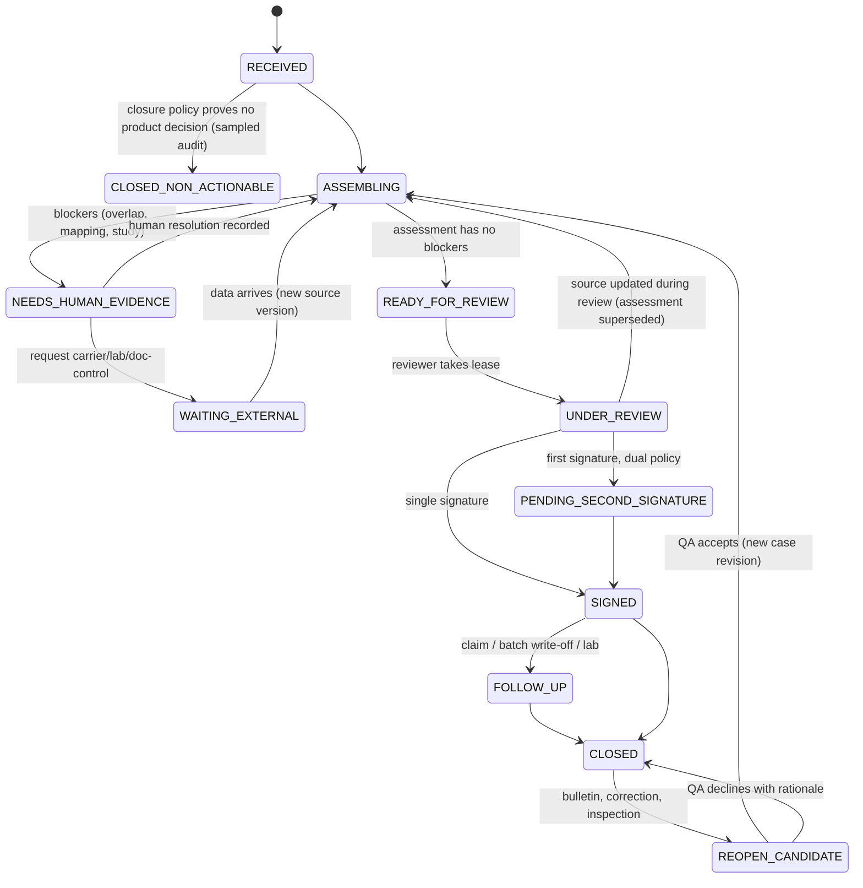
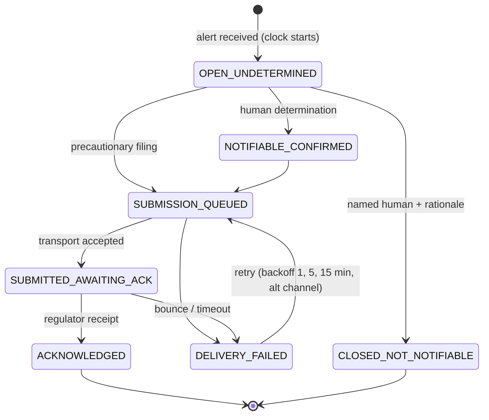
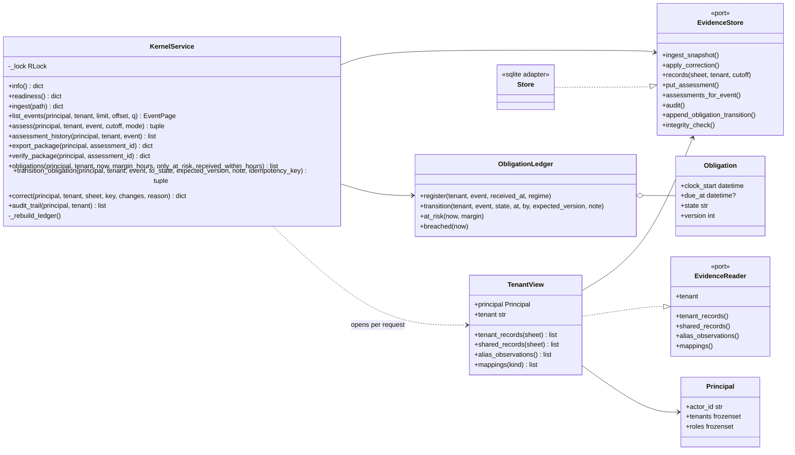
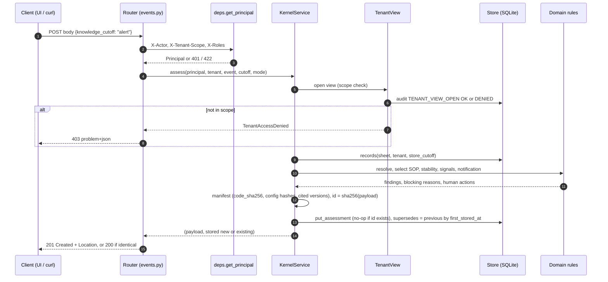
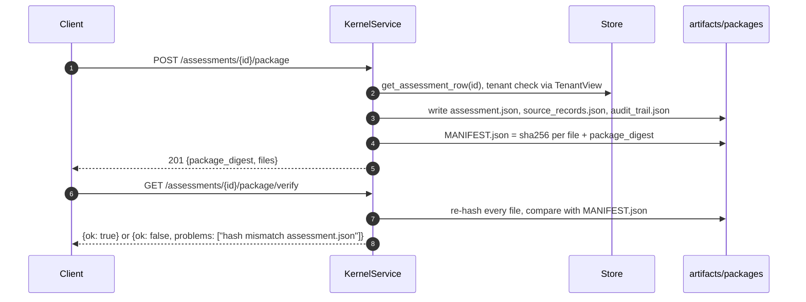
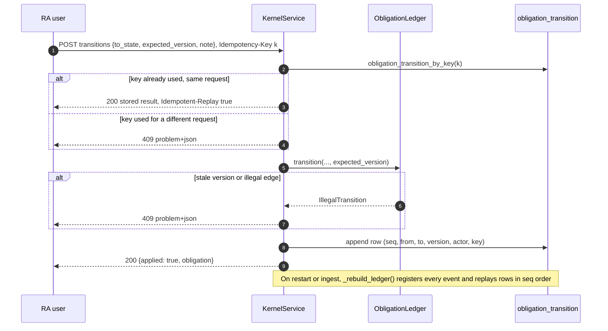
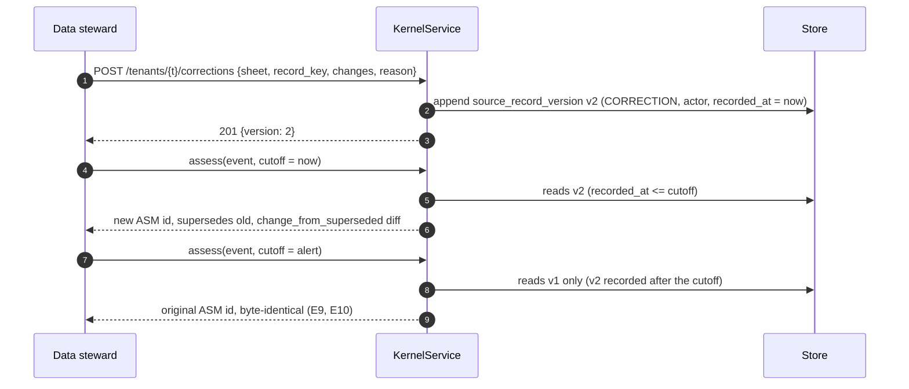
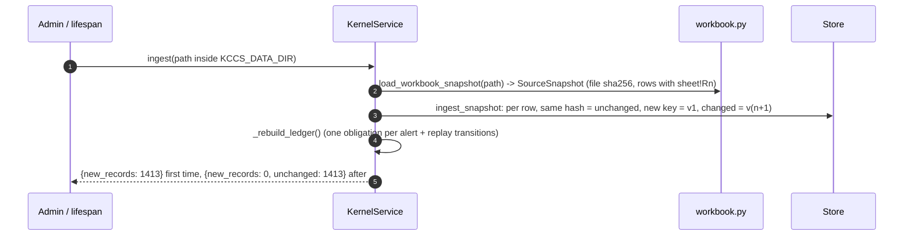
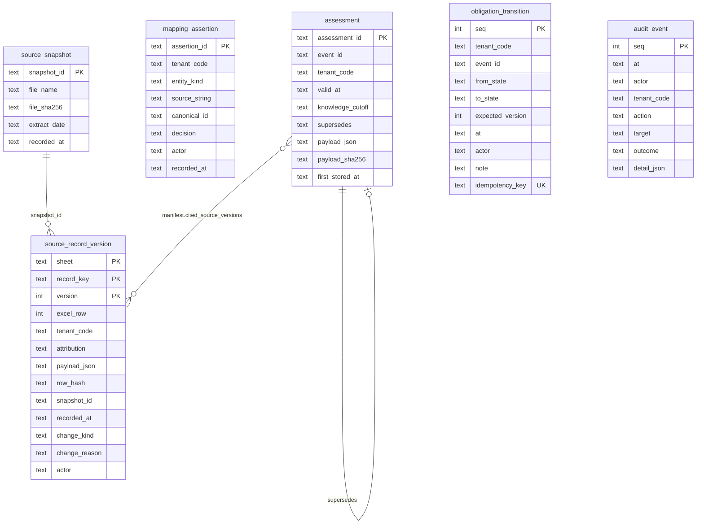
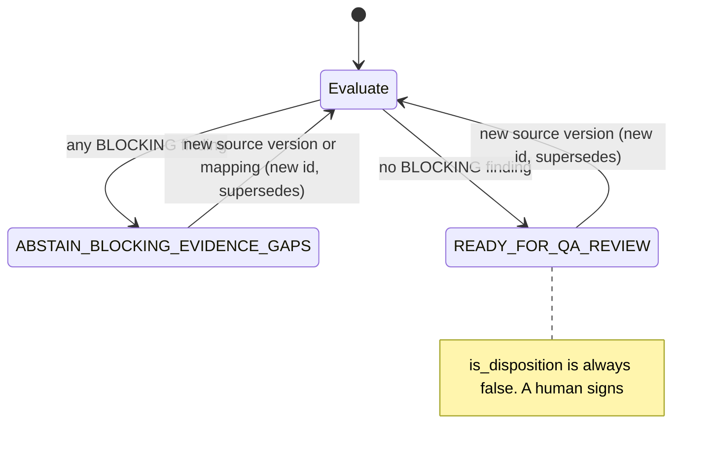

# 03 — Detailed design (LLD)

Legend: **[IMPL]** in prototype · **[SIM]** stubbed · **[DESIGN]** proposed.

## 1. Time model

| Concept | Definition | Where |
|---|---|---|
| **Valid time** | When a fact or policy applied in the world. SOP revisions: `[effective_from, effective_to)` of **site-local calendar dates**. Contracts: the same convention, on the governing-law date. An excursion's valid instant is `excursion_start_utc` | `domain/temporal.py`, `domain/policy_sop.py` [IMPL] |
| **Recorded (knowledge) time** | When *this system* learned a version (`source_record_version.recorded_at`, `mapping_assertion.recorded_at`). Never inferred from valid time | `infrastructure/sqlite_store.py` [IMPL] |
| **Receipt time** | `alert_ts_utc`: when the reading reached Sentinel. Starts the notification clock (`00!R43`) | `domain/obligations.py` [IMPL] |
| **Interval convention** | Half-open. Evidence: 115 hand-overs in `05` have `effective_to == next effective_from`. A blank `effective_to` (or "evergreen") is open | [IMPL] |
| **Date-only policies & timezone** | The local date at the **governed site** decides (Kundli SOP → Asia/Kolkata). If the site is unresolved or its timezone is untrusted (MEM-CS-02 confirmed wrong, IND-CS-01 suspect), every plausible date between UTC−12 and UTC+14 is evaluated, and a differing selection is `BOUNDARY_AMBIGUOUS` (blocking) | [IMPL] |
| **Two questions** | *"What did we know then?"* = strict mode: only versions with `recorded_at ≤ cutoff`. *"What do we conclude now about then?"* = valid time at the excursion, knowledge at a later cutoff | [IMPL] `mode=STRICT/RECONSTRUCTED` |
| **Reconstructed mode (pack limitation)** | The pack has no recorded-time history, so its snapshot is treated as a backfilled baseline. Anything recorded *after* the baseline (corrections, mappings) is visible only if `recorded_at ≤ cutoff`. Domain knowledge dates gate further: alias `confirmed_on`, bulletin `known_from`, precedent signature time, product-master `last_updated` (flagged when after the alert). Every reconstructed assessment carries `KNOWLEDGE_TIME_RECONSTRUCTED` | [IMPL] |
| **Supersession** | New versions append; nothing is updated or deleted (DB triggers). A signed disposition references an assessment ID, which references exact source versions; later corrections produce a new assessment with `supersedes` and a `change_from_superseded` diff | [IMPL] |
| **Conflicts** | Two in-force revisions, a master vs study limit, an ambiguous identifier, or attribution disagreement → BLOCKING finding naming every candidate. No ranking, no "latest row wins" | [IMPL] |

## 2. Data model (production, Postgres per cell)

Conventions: every tenant-scoped table has `tenant_code NOT NULL` as the leading column of its primary key or index. Row-level security uses a `app.tenant` session variable as a second line of defence behind the application `TenantView`. The prototype's SQLite schema (`infrastructure/sqlite_store.py`, shown in §10) implements the starred (★) tables.

| Table | Key / important columns | Constraints & indexes |
|---|---|---|
| `tenant` | `tenant_code` PK, `cell`, `residency`, `model_route`, `signature_policy_id`, `output_languages[]`, `notification_regime_id` | route ∈ {NONE, EU_ZR, ANY_ZR}; changes versioned in `tenant_policy_version` |
| `tenant_policy_version` | (`tenant_code`, `version`) PK, `valid_from`, `recorded_at`, `policy_json`, `approved_by` | append-only |
| ★`source_snapshot` | `snapshot_id` PK, `source_system`, `file_sha256`/`batch_id`, `recorded_at` | |
| ★`source_record_version` | (`sheet/source`, `record_key`, `version`) PK, `tenant_code` NULL only for shared/unattributed, `payload_json`, `row_hash`, `recorded_at`, `change_kind` {INGEST, CORRECTION}, `actor`, `reason` | UPDATE/DELETE trigger → abort; idx (`source`, `tenant_code`, `recorded_at`) |
| `canonical_entity` | (`tenant_code`, `kind`, `entity_id`) PK; kind ∈ PRODUCT_PRESENTATION, FACILITY_SITE (shared), CARRIER_LEGAL_ENTITY (shared) | products are tenant-scoped even when GTINs match across tenants |
| ★`mapping_assertion` | `assertion_id` PK, `tenant_code` (NULL for Kestrel-owned kinds), `kind`, `source_string`, `canonical_id`, `decision` {APPROVED, REJECTED}, `actor`, `recorded_at`, `evidence_ref` | unique (`tenant_code`, `kind`, norm(`source_string`), `recorded_at`); latest decision wins *as of cutoff* |
| `alias_observation` | imported `07` rows, `attribution` {UNATTRIBUTED, TENANT}, `confirmed_on` | product rows UNATTRIBUTED are unreadable by policy |
| `product_presentation` | (`tenant_code`, `product_id`) PK, `presentation` {PEN, VIAL, PFS,…}, `strength`, `gtin`, `sku`, `spec_low_c`, `spec_high_c`, valid interval | spec changes are new versions (`00!R34`) |
| `facility_site` | `site_code` PK, `country`, `iana_tz`, `tz_status` {TRUSTED, SUSPECT, WRONG}, `gmp_licences[]` | |
| `carrier_legal_entity` / `carrier_contract` | `contract_id` PK, `legal_entity_id`, `[effective_from, effective_to)`, `cold_chain_clause`, `claim_window_days`, `claim_trigger` | amendments as `contract_amendment` rows |
| `shipment` / `leg` | (`tenant_code`, `shipment_ref`) PK; `leg_no`, carrier legal entity per **leg** (EXC-110581) | |
| `batch`, `pallet_exposure` | (`tenant_code`, `batch_id`); per-pallet exposure intervals | not in pack → cumulative checks abstain |
| `sensor`, `firmware_build`, `calibration_bulletin` | bulletin: `firmware`, `direction`, `magnitude_min/max`, `exact_correction_known`, `known_from` | drives reopen candidates |
| `controlled_document` / `doc_revision` / `annexure` | (`tenant_code`, `doc_id`, `revision`) PK; `[from,to)`, `scope_rule_id`, `format`, `content_sha256`, `extracted_limits_json` + `verified_by` | overlaps allowed in data and **detected** at query time |
| `stability_study` | (`tenant_code`, `study_ref`) PK, `presentation`, `study_type`, `readability`, `permitted_excursion` (only if verified), `content_sha256` | owner = `tenant_code`, never the path |
| `alert` | (`tenant_code`, `event_id`) PK, `source_msg_id` unique per source, `alert_received_at`, `excursion_start`, aggregates | dedupe key (`source_system`, `source_msg_id`) |
| `case` | (`tenant_code`, `case_id`) PK, `state`, `version` (optimistic lock), `lease_holder`, `lease_until` | |
| ★`assessment` | `assessment_id` = content hash, `case_id`, `valid_at`, `knowledge_cutoff`, `supersedes`, `payload`, `payload_sha256` | immutable |
| `signed_disposition` | `signature_id` PK, `case_id`, `assessment_id`, `disposition`, `signer`, `signature_method`, `signed_at`, `second_signature_id` | immutable; reopen never edits |
| `notification_obligation` | (`tenant_code`, `event_id`) PK, `clock_start`, `due_at`, `regime_version`, `state`, `version` | `due_at` written once; idx (`state`, `due_at`) |
| ★`obligation_transition` | `seq` PK, `tenant_code`, `event_id`, `from_state`, `to_state`, `expected_version`, `at`, `actor`, `note`, `idempotency_key` UNIQUE | append-only event log; the ledger is rebuilt from it |
| `submission_attempt` / `acknowledgement` | attempt → transport result; ack with regulator reference | only an ack satisfies |
| `evidence_package` | `package_digest` PK, `assessment_id`/`signature_id`, `object_uri` (WORM), `retention_until` | |
| ★`audit_event` | seq, at, actor, tenant, action, target, outcome, detail | append-only, exported daily to WORM |
| `execution_manifest` | embedded in each assessment: code fingerprint, ruleset, config hashes, cited source versions, model route/version/params, stubs | |
| `outbox` | `id`, `aggregate`, `type`, `payload`, `created_at`, `dispatched_at` | written in the same transaction as the state change |

## 3. Interfaces: production contracts (representative)

> The **endpoints the prototype actually serves** are listed in §11, with real request and response examples. This section is the wider production contract, including design-only endpoints such as case decisions and reopen.

All endpoints require an authenticated principal with tenant scopes. They carry `X-Tenant`, which must be in scope or the request returns **403 + audit** (the existence of other tenants' records is never revealed; unknown IDs return 404). Mutations take an `Idempotency-Key` and, where they change state, an `expected_version` (409 on mismatch). Retryable errors: 429/503 with `Retry-After`. All responses include `schema_version`.

```http
POST /v1/alerts                      # ingest an alert [DESIGN]; prototype: `kccs-evidence ingest`
Idempotency-Key: SYS-02:<source_msg_id>
{ "tenant_code":"T-KAVERI", "source_system":"SYS-01", "source_msg_id":"...", "event_id":"EXC-107133",
  "alert_received_at":"2026-07-28T06:31:00Z", "excursion_start":"2026-07-28T06:14:00Z", "excursion_end":"...",
  "logger":{"id":"LG-40843","vendor":"ThermaTrace","fw":"TT-2.15.0"}, "aggregates":{"min_c":5.4,"max_c":11.2,"duration_min":15},
  "refs_as_received":{"product":"08901234500035","origin":"Bhiwandi Hub","dest":"Kundli Pharma Store","carrier":"Tapti Exp Cargo"} }
→ 201 {"event_id":..., "obligation":{"due_at":"...","state":"OPEN_UNDETERMINED"}, "attribution":"NATIVE|DERIVED|QUARANTINED"}
→ 200 same body on replay of the same Idempotency-Key; 422 on invalid timestamps (no timezone) or unknown tenant
```

```http
POST /v1/tenants/{t}/resolve         # [IMPL] resolution.py
{ "kind":"PRODUCT", "value":"08901234500035", "knowledge_cutoff":"2026-07-28T06:31:00Z" }
→ 200 {"status":"RESOLVED|RESOLVED_PROVISIONAL|AMBIGUOUS|UNRESOLVED|MISSING_INPUT","resolved_id":"02_Product_Master!R57",
       "basis":"EXACT_GTIN","candidates":[...],"findings":[...]}
POST /v1/tenants/{t}/mappings        # human approval; role QA_MAPPING_APPROVER; append-only
{ "kind":"FACILITY","source_string":"F00231","canonical_id":"BLR-CS-02","decision":"APPROVED","evidence_ref":"07!R5" }
```

```http
GET /v1/tenants/{t}/evidence?event=EXC-107133&valid_at=2026-07-28T06:14Z&knowledge_cutoff=2026-07-28T06:31Z&mode=RECONSTRUCTED
→ 200 { "sop_origin":[{"doc_id":"SOP-KAV-9392","status":"CONFLICT_OVERLAPPING_REVISIONS","in_force":["Rev 02","Rev 03"]}],
        "stability":{"status":"CANDIDATE_ONLY", ...}, "time_semantics":{...} }
```

```http
POST /v1/tenants/{t}/assessments     # [IMPL] assess_and_store; idempotent by content hash
{ "event_id":"EXC-107133", "knowledge_cutoff":"alert|now|<ISO>", "mode":"RECONSTRUCTED|STRICT" }
→ 201 new / 200 existing  { "assessment_id":"ASM-…", "disposition_evidence_status":"ABSTAIN_BLOCKING_EVIDENCE_GAPS",
        "blocking_reasons":[...], "required_human_actions":[...], "manifest":{...}, "supersedes":"ASM-…?" }
```

```http
POST /v1/tenants/{t}/cases/{case}/decisions          # [DESIGN]
{ "expected_version":7, "assessment_id":"ASM-…", "disposition":"RELEASE_WITH_NOTE", "rationale":"…",
  "signature":{"method":"PART11_2FA","assertion":"…"} }
Guards: assessment is the case's latest; status READY_FOR_QA_REVIEW OR every blocking finding has a recorded human
resolution; signer satisfies the tenant signature policy; dual → state PENDING_SECOND_SIGNATURE.
→ 201 {"signature_id":…, "package_digest":…}   409 stale version / newer assessment   403 signer not authorised
POST /v1/tenants/{t}/cases/{case}/reopen              # [DESIGN]
{ "expected_version":9, "trigger":"BULLETIN:TT-CB-114", "assessment_id":"ASM-new" }
→ original signature + package untouched; new case revision with link; liability follow-up created if invoiced (INC-2506)
GET  /v1/tenants/{t}/packages/{assessment_or_signature_id}   # [IMPL] export_package / verify_package
→ 200 zip: assessment.json, source_records.json, audit_trail.json, MANIFEST.json (sha256 per file + digest)
POST /v1/tenants/{t}/obligations/{event}/transitions   # [IMPL] ObligationLedger.transition
{ "expected_version":3, "to":"SUBMISSION_QUEUED|SUBMITTED_AWAITING_ACK|DELIVERY_FAILED|ACKNOWLEDGED|NOTIFIABLE_CONFIRMED|CLOSED_NOT_NOTIFIABLE",
  "note":"…", "ack_reference":"…" }
→ 409 version conflict; 422 illegal transition; CLOSED_NOT_NOTIFIABLE requires a named human + rationale
```

## 4. Case workflow (disposition) [DESIGN; assessment states IMPL]



| State | Trigger | Guards | Action | Next | Timeout / escalation (proposed) | Audit event |
|---|---|---|---|---|---|---|
| RECEIVED | alert ingested | tenant attributed | create obligation (same txn); assess | ASSEMBLING / CLOSED_NON_ACTIONABLE | — | ALERT_RECEIVED |
| RECEIVED | closure policy | closure reason verifiable (duplicate with same physical excursion key; no product in room per TMS) and **no** product-exposure uncertainty | close, 5% blind audit sample | CLOSED_NON_ACTIONABLE | — | ALERT_CLOSED_NON_ACTIONABLE |
| ASSEMBLING | assessment built | — | store assessment | READY_FOR_REVIEW / NEEDS_HUMAN_EVIDENCE | 15 min to first assessment | ASSESSMENT_BUILD |
| NEEDS_HUMAN_EVIDENCE | QA resolves conflict / approves mapping | role-appropriate; resolution cites evidence | append mapping/resolution; reassess | ASSEMBLING | 1 business day → QA lead | HUMAN_EVIDENCE_RESOLVED |
| NEEDS_HUMAN_EVIDENCE | request external data | — | outbox request (carrier/lab/doc-control) | WAITING_EXTERNAL | — | EXTERNAL_REQUESTED |
| WAITING_EXTERNAL | data arrives | new source version | reassess | ASSEMBLING | carrier 24 h, lab per SLA, then QA lead. **Notification clock unaffected** | EXTERNAL_RECEIVED |
| READY_FOR_REVIEW | reviewer claims | lease free; reviewer authorised for tenant | lease 30 min, renewable | UNDER_REVIEW | lease expiry → back to queue | LEASE_ACQUIRED |
| UNDER_REVIEW | concurrent action | `expected_version` matches | — | — | 409 to the loser | CONFLICT_REJECTED |
| UNDER_REVIEW | source update during review | — | supersede assessment; signing against the old ID returns 409 | ASSEMBLING | — | ASSESSMENT_SUPERSEDED |
| UNDER_REVIEW | sign | signer policy; latest assessment; blockers resolved | seal package (WORM) | SIGNED / PENDING_SECOND_SIGNATURE | — | DISPOSITION_SIGNED |
| PENDING_SECOND_SIGNATURE | second signer | different person; role per tenant | seal | SIGNED | 8 h → corporate QA | SECOND_SIGNATURE |
| SIGNED | liability follow-up | carrier resolved & contract clause | create claim task (claim window) | FOLLOW_UP | claim window − 3 days | CLAIM_OPENED |
| CLOSED | bulletin / correction | knowledge-time diff adds firmware/limit findings | create reopen candidate; **original signature untouched** | REOPEN_CANDIDATE | 5 business days | REOPEN_CANDIDATE |
| REOPEN_CANDIDATE | QA accepts | — | new case revision; withdraw invoices if carrier-billed (INC-2506) | ASSEMBLING | — | CASE_REOPENED |

## 5. Notification lifecycle (independent) [IMPL in `domain/obligations.py`, persisted by `application/service.py`]



Escalation (proposed): an open obligation at T−24 h goes to the Regulatory Affairs queue; at T−6 h it pages the on-call RA lead; at T−1 h it pages the RA manager plus a precautionary filing prompt. If `due_at` cannot be computed (next-business-day policy incomplete), it escalates immediately. A queued email or transport 250-OK is **not** completion.

## 6. Reliability

- **At-least-once ingest, idempotent effects:** dedupe on (`source_system`, `source_msg_id`); SYS-02 duplicates after a reboot (`11!R3`) collapse. Assessment IDs are content hashes, and obligation registration is keyed by (`tenant`, `event`) [IMPL].
- **Outbox:** state change and outbox row in one transaction; a dispatcher delivers with retries; consumers are idempotent [DESIGN].
- **Durable timers:** `due_at` and escalation times are columns; a scheduler polls `state IN open AND next_escalation_at <= now()` with `FOR UPDATE SKIP LOCKED`. After a crash it simply resumes [DESIGN].
- **Backpressure & noisy tenants:** per-tenant queues with weighted fair dequeue; storm detector groups alerts by (site, room, 10-min window) **for display only**; obligations stay one per alert [IMPL test].
- **Deadline-aware scheduling:** reviewer worklist ordered by obligation `due_at`, then case age. Policy-incomplete obligations come first [IMPL `at_risk`].
- **Fail-closed:** missing tenant scope → deny; unknown attribution → quarantine; evidence service unavailable → abstain, never a default "pass" [IMPL].
- **Manual operation:** if model, retrieval or kernel are down, reviewers work from source systems as today. The obligation ledger has a manual entry UI and paper-runbook reconciliation [DESIGN].
- **Recovery:** proposed RPO 5 min / RTO 1 h per cell, not demonstrated. WORM package store is cross-zone replicated within the cell's region. After recovery: replay ingestion from source offsets (Kafka/CDC), then reconcile obligation counts against the source alert count per tenant per hour [DESIGN].

## 7. Versioning and delivery pipeline [DESIGN; manifest IMPL]

| Artefact | Versioned how |
|---|---|
| Application code | git SHA + package fingerprint in the manifest (`code_sha256`) |
| DB schema | migration number (`store_schema_version`); forward-only, expand/contract |
| Entity mappings | `mapping_assertion` rows (actor, recorded_at) |
| Rules, tenant policy, scope interpretations, bulletins, regimes | JSON config with `version` + sha256 in the manifest; QA-approved PR |
| Documents & extracted facts | `doc_revision.content_sha256`; extracted limits carry `verified_by` |
| Retrieval/index config | index build ID per tenant (embedding model, chunking, filter) |
| Prompt templates, model + parameters | template hash, provider/model/version, temperature; per-tenant route |
| Evaluation datasets & scoring | frozen replay sets per tenant (hash), scoring policy version |

Pipeline:
1. CI: lint, unit, synthetic-fixture tests, isolation suite.
2. **Historical replay per tenant** against frozen sets, with a diff report (status/finding changes per tenant). Any tenant with a non-empty diff must be named in the change request.
3. **QA approval** of the diff by Dr Rao's delegate.
4. **Shadow** (outputs stored, not shown) for 1 week.
5. **Canary** to one tenant (proposed 3 days).
6. Progressive rollout by cell.
7. **Rollback** by flipping the config/code version pointer; assessments made under the old version remain valid records.
8. **Emergency disable** per tenant and per route (model off → template route; kernel off → current manual process).
9. **Qualified fallback:** the no-LLM route is always qualified, so a model sunset (INC-2509) never forces an unqualified model.
10. **Model sunset plan:** accept only providers with ≥ 6 months' notice (A, C). Maintain a pre-qualified second model; re-qualification uses the same replay harness.
11. **Dependencies:** pinned (`pyproject.toml`), with a scanner in CI.

---

# Part 2: the prototype as built (module level)

Sections 8–14 describe the code in `src/kccs_evidence/` exactly as it runs. All examples are real responses from the API (EXC-107133, fixed clock `KCCS_FIXED_NOW=2026-11-08T12:00:00Z`).

## 8. Module map and main classes



| File | Responsibility | Key functions |
|---|---|---|
| `domain/records.py` | Canonical JSON, row hashes, `SourceRecord`, `SourceSnapshot`, `VersionedRecord` | `canonical_json`, `row_hash` |
| `domain/temporal.py` | UTC parsing, half-open intervals, site-local dates, cutoff resolution | `in_half_open`, `plausible_local_dates`, `parse_effective_to` |
| `domain/resolution.py` | Product / facility / carrier resolution inside one tenant; human-approved mappings only | `resolve_product`, `resolve_facility`, `resolve_carrier` |
| `domain/policy_sop.py` | SOP revision in force at a site on a local date; overlap → conflict | `select_sop` |
| `domain/stability.py` | Study admissibility (owner, presentation, readability, type), master vs study | `assess_study`, `assess_stability`, `study_presentations` |
| `domain/signals.py` | Spec and limit parsing, firmware uncertainty band, limit evaluation, telemetry gap findings | `parse_limit`, `firmware_uncertainty`, `evaluate_limit`, `telemetry_findings` |
| `domain/obligations.py` | Notification clock and state machine (pure) | `compute_due_at`, `ObligationLedger` |
| `domain/ports.py` | `EvidenceReader` protocol used by the rules | — |
| `application/access.py` | `Principal`, `TenantView` (scope check + audit before any read) | `TenantView.__init__` |
| `application/assessment.py` | Build the assessment (incl. knowledge-gated lane history, liability, notification track), manifest, fingerprint, store, supersession diff | `resolve_cutoff`, `build_assessment`, `assess_and_store`, `code_fingerprint` |
| `application/package.py` | Export / verify hashed evidence packages | `export_package`, `verify_package` |
| `application/evaluation.py` | Replay over all events vs historical outcomes (Dr Rao's condition) | `evaluate` |
| `application/service.py` | Facade used by CLI and API; ledger rebuild; idempotency | `KernelService` |
| `application/ports.py` | `EvidenceStore` protocol | — |
| `infrastructure/sqlite_store.py` | SQLite schema, append-only triggers, bitemporal reads | `Store` |
| `infrastructure/workbook.py` | openpyxl reader, keeps GTINs as strings, row refs `sheet!Rn` | `load_workbook_snapshot` |
| `interfaces/cli.py` | `kccs-evidence` commands, exit codes 2/3/4 | `main` |
| `interfaces/api/*` | FastAPI app factory, settings, problem+json, identity deps, routers | `create_app` |
| `interfaces/web/*` | Static reviewer UI | — |

## 9. Sequence diagrams

### 9.1 Assess an event (POST `/api/v1/tenants/{t}/events/{e}/assessments`)



### 9.2 Export and verify an evidence package



### 9.3 Obligation transition (optimistic lock + idempotency)



### 9.4 Correction and supersession (the "unseen change" path)



### 9.5 Ingest (start-up autoload or POST `/api/v1/ingest`)



## 10. Data model of the prototype (SQLite, `STORE_SCHEMA_VERSION = 2`)



- **Bitemporal reads:** `records(sheet, tenant, cutoff)` returns, for each `record_key`, the highest `version` with `recorded_at <= cutoff`.
- **Immutability:** `BEFORE UPDATE` and `BEFORE DELETE` triggers on all six tables raise `ABORT`. `integrity_check()` confirms the triggers exist and re-hashes `payload_json` against `payload_sha256` for every assessment.
- **Indexes:** `ix_srv_tenant (sheet, tenant_code, recorded_at)`, `ix_assessment_event (tenant_code, event_id)`, `ix_obl_tr (tenant_code, event_id, seq)`.
- **Production mapping:** each table maps one-to-one to the ★ tables in §2. Postgres adds RLS on `tenant_code` and partitions by tenant.

## 11. REST API contract (as served; OpenAPI at `/docs` and `/openapi.json`)

**Identity headers (prototype, ADR 0008):**

| Header | Required | Example |
|---|---|---|
| `X-Actor` | yes | `demo-qa` |
| `X-Tenant-Scope` | yes | `T-KAVERI` or `T-KAVERI,T-AURA` |
| `X-Roles` | no | `QA_REVIEWER` (the default) |

**Endpoints:**

| Method & path | Role | Success | Errors |
|---|---|---|---|
| `GET /health/live` | none | 200 `{status: "ok"}` | — |
| `GET /health/ready` | none | 200 readiness body | 503 not loaded or integrity failure |
| `GET /metrics` | none | Prometheus text | — |
| `GET /api/v1/system/info` | none | versions, code_sha256, config hashes, snapshots, tenants | — |
| `POST /api/v1/ingest` `{path?}` | PLATFORM_ADMIN | 200 `{new_records, new_versions, unchanged}` | 403, 404, 422 (path outside data dir) |
| `GET /api/v1/tenants` | any | tenants in scope | 401 |
| `GET /api/v1/tenants/{t}/events?limit&offset&q` | any | page of events (no outcome fields) with `latest_assessment` | 401, 403, 422, 503 |
| `GET /api/v1/tenants/{t}/events/{e}` | any | one event | 404 (never reveals other tenants) |
| `POST /api/v1/tenants/{t}/events/{e}/assessments` `{knowledge_cutoff: alert\|extract\|now\|ISO, mode: RECONSTRUCTED\|STRICT}` | any | **201** new + `Location`, **200** identical | 403, 404, 422 |
| `GET /api/v1/tenants/{t}/events/{e}/assessments` | any | history chain, oldest first | 403, 404 |
| `GET /api/v1/assessments/{id}` | any (tenant-checked) | assessment | 403, 404, 422 |
| `POST /api/v1/assessments/{id}/package` | any (tenant-checked) | 201 `{package_digest, files}` | 403, 404 |
| `GET /api/v1/assessments/{id}/package/verify` | same | `{ok, problems[], package_digest}` | 404 |
| `GET /api/v1/assessments/{id}/package.zip` | same | `application/zip` | 404 |
| `POST /api/v1/assessments/{id}/package/tamper-demo` | same; only if `KCCS_DEMO_ENDPOINTS=true` | original ok + tampered copy fails | 404 if disabled |
| `GET /api/v1/obligations/queue?as_of&margin_hours&only_at_risk&received_within_hours` | any | queue across all tenants in scope | 422 naive `as_of` |
| `GET /api/v1/tenants/{t}/obligations?...` | any | one tenant's queue | 403 |
| `POST /api/v1/tenants/{t}/obligations/{e}/transitions` `{to_state, expected_version, note}` + `Idempotency-Key` | REGULATORY_AFFAIRS | 200 `{applied, obligation}` | 403, 404, 409 |
| `POST /api/v1/tenants/{t}/corrections` `{sheet, record_key, changes, reason}` | QA_DATA_STEWARD | 201 `{version}` | 403, 404, 422 |
| `GET /api/v1/tenants/{t}/audit` | any | audit rows for that tenant | 403 |

**Real examples:**

```http
POST /api/v1/tenants/T-KAVERI/events/EXC-107133/assessments
X-Actor: demo-qa
X-Tenant-Scope: T-KAVERI
{"knowledge_cutoff":"alert"}

HTTP/1.1 201 Created
location: /api/v1/assessments/ASM-ac3e4e7b0db4567a09c245ad
{"stored":"new","assessment_id":"ASM-ac3e4e7b0db4567a09c245ad","status":"ABSTAIN_BLOCKING_EVIDENCE_GAPS",
 "assessment":{"schema_version":"assessment/1.0","is_disposition":false,
   "blocking_reasons":["SOP_REVISION_OVERLAP","STABILITY_MASTER_VS_STUDY_CONFLICT",
                       "STABILITY_REFERENCED_STUDY_INADMISSIBLE","TEMPERATURE_SERIES_NOT_AVAILABLE"],
   "entities":{...}, "evidence":{...}, "notification_track":{...}, "findings":[...],
   "required_human_actions":[...], "reviewer_aid":{...},
   "manifest":{"kernel_version":"0.2.0","ruleset_version":"evidence-rules/0.1.0","store_schema_version":2,
               "code_sha256":"d9f32f30…","config":{...},"cited_source_versions":[...8 items],
               "model":{"route":"NONE"}, "stubs":{"telemetry_archive":"NOT_AVAILABLE", ...}}}}
```

```http
GET /api/v1/tenants/T-AURA/events          (caller scoped to T-KAVERI)
HTTP/1.1 403
content-type: application/problem+json
{"type":"https://kccs.example/problems/access-denied","title":"Access denied","status":403,
 "detail":"demo-qa is not authorised for T-AURA","instance":"/api/v1/tenants/T-AURA/events","request_id":"33fa21ed2130468e"}
```

```http
GET /api/v1/obligations/queue?as_of=2026-07-28T12:00:00Z&only_at_risk=false&received_within_hours=24
{"as_of_utc":"2026-07-28T12:00:00Z","margin_hours":24.0,"only_at_risk":false,"count":1,
 "items":[{"obligation_id":"OBL-T-KAVERI-EXC-107133","clock_start_utc":"2026-07-28T06:31:00Z",
           "due_at_utc":"2026-08-12T06:31:00Z","regime_kind":"ELAPSED_HOURS","state":"OPEN_UNDETERMINED",
           "version":1,"hours_remaining":354.52,"breached":false,"escalate_now":false, "history":[...]}]}
```

## 12. Error handling

All errors use `application/problem+json` (RFC 9457) with `type`, `title`, `status`, `detail`, `instance` and `request_id`. The mapping lives in `interfaces/api/errors.py`:

| Raised | HTTP | Meaning for the client |
|---|---|---|
| Missing `X-Actor` / `X-Tenant-Scope` | 401 | Send identity |
| Malformed identity, `RequestValidationError`, `ValueError`, `PolicyIncomplete` | 422 | Fix the request; `errors[]` lists the fields |
| `TenantAccessDenied`, missing role | 403 | Not allowed; the attempt is audited |
| `KeyError`, `FileNotFoundError` | 404 | Unknown in **your** tenant (other tenants are never revealed) |
| `IllegalTransition` (stale version, illegal edge, reused key) | 409 | Re-read and retry with the current version |
| `NotReady` (no workbook loaded) | 503 | Wait for readiness |
| Anything else | 500 | Generic message; the stack trace is in the server log under the same `request_id` |

The CLI uses exit codes instead: 0 ok, 2 invalid or verify failed, 3 access denied, 4 not found.

**Fail-closed rules inside the kernel:**
- an SOP revision with no start date is never "in force";
- an unknown regime gives `REGIME_UNKNOWN` (no deadline, escalate);
- a missing series is a blocking finding, never a pass.

## 13. State machines as implemented

**Assessment status** (computed, not stored as a workflow):



**Notification obligation:** see the diagram in §5. The code table is `TRANSITIONS` in `domain/obligations.py`:

| From | Allowed to |
|---|---|
| OPEN_UNDETERMINED | NOTIFIABLE_CONFIRMED, CLOSED_NOT_NOTIFIABLE (named human + note), SUBMISSION_QUEUED |
| NOTIFIABLE_CONFIRMED | SUBMISSION_QUEUED |
| SUBMISSION_QUEUED | SUBMITTED_AWAITING_ACK, DELIVERY_FAILED |
| DELIVERY_FAILED | SUBMISSION_QUEUED |
| SUBMITTED_AWAITING_ACK | ACKNOWLEDGED, DELIVERY_FAILED |
| ACKNOWLEDGED, CLOSED_NOT_NOTIFIABLE | — (terminal; `satisfied = true`) |

Every transition needs `expected_version == current version` and increments it.

## 14. Key algorithms

1. **Knowledge cutoff resolution.**
   - `alert` maps to `alert_ts_utc`; `extract` to `2026-09-14T23:59:00Z`; `now` to the clock.
   - An ISO value must carry a timezone.
   - A cutoff before the alert is rejected (`test_cutoff_before_alert_rejected`).
   - In RECONSTRUCTED mode, the store cutoff is `max(cutoff, baseline snapshot recorded_at)`, so the back-filled baseline is visible while later corrections are not.
2. **SOP selection.**
   - For each candidate site, take the site's IANA timezone.
   - If it is trusted, use one local date. Otherwise use every local date reachable from UTC−12 to UTC+14.
   - For each date, collect the revisions with `from <= d < to`, filtered by the scope rules in `config/sop_scope_rules.json`.
   - The outcome is one of:
     - exactly one revision: `SELECTED`;
     - none: `NONE_IN_FORCE`;
     - more than one: `CONFLICT_OVERLAPPING_REVISIONS`;
     - different results on different dates: `BOUNDARY_AMBIGUOUS`.
3. **Stability admissibility.**
   - The owner is `tenant_code`, not the path.
   - The presentation comes from the study's suffix after "—" or its trailing parenthesis. Explicit words (pen, vial, PFS) beat brand tokens; this was bug #9 in the working log.
   - Readable must be `Y`.
   - The study type must establish an excursion limit, which "Accelerated" does not.
   - Each failed check is a stated rejection reason.
   - An admissible but unreferenced study is a `CANDIDATE`, never silently used.
4. **Firmware band.** A bulletin "under-reports by up to X °C" turns the reading into an interval `[r, r + X]`. If the limit check gives different answers at the two ends, the finding is `LIMIT_CHECK_FLIPS_WITHIN_FIRMWARE_BAND`. The bulletin is used only if `known_from <= cutoff`.
5. **Deadline.**
   - `ELAPSED_HOURS`: `due = alert_received_at + hours`.
   - `NEXT_BUSINESS_DAY`: the next local weekday that is not a holiday, at the deadline time. If the timezone, calendar or time is missing, raise `PolicyIncomplete`, keep the obligation with `due = null`, and list it first.
6. **Queue.**
   - Take the open obligations with `clock_start <= as_of` (and `>= as_of - received_within_hours` if given).
   - If `only_at_risk`, keep only those with `due = null` or `due - as_of <= margin`.
   - Sort by `(due is not null, due)`: earliest deadline first, policy-incomplete on top.
7. **Assessment ID.** `"ASM-" + sha256(canonical_json(payload))[:24]`, computed before `assessment_id` and `runtime` (Python version, requesting actor) are added. That is why the actor does not change the ID (`test_assessment_id_independent_of_requesting_actor`). Canonical JSON uses sorted keys and fixed separators.
   - `code_sha256` hashes the sorted relative paths and bytes of every `.py` file under `domain/`, `application/`, `infrastructure/` and `config/`, plus the package `__init__.py`.
   - The `config` hashes cover the JSON rule files.
8. **Package digest.** `MANIFEST.json` lists `{file: sha256}`. `package_digest = sha256(canonical_json(files_sha256))`. Verify recomputes both. Any difference names the file.
9. **Ingest idempotency.** `row_hash = sha256(canonical_json({sheet, payload}))`. The same hash adds nothing; a changed payload under the same key adds `version + 1`.
